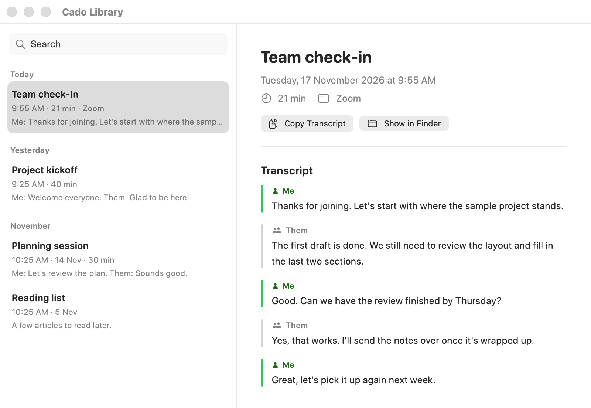

# Cado site

Plain static HTML + CSS + a little inline JS. No build step, no dependencies, no third-party requests.
Live at <https://ropats16.github.io/cado/>. All paths are relative so it works under `/cado/`.

## Preview

```sh
python3 -m http.server 8000 --directory site
# open http://localhost:8000/
```

## Deploy

`.github/workflows/pages.yml` publishes `site/` to GitHub Pages on every push to `main` that touches `site/**`
(or run it by hand: Actions > Pages > Run workflow). One-time: repo Settings > Pages > Source = **GitHub Actions**.

The Download button points at `https://github.com/ropats16/cado/releases/latest`, so it needs no edit per release.

## Add a review quote

Real quotes only, with the person's permission. Edit the JSON list near the bottom of `index.html`
(`<script type="application/json" id="quotes-data">`). While it is `[]` the Reviews section and its nav link stay hidden.

```json
[{"text": "<their words, exactly>", "name": "<how they want to be credited>", "link": "https://optional-source"}]
```

## Add a screenshot

Capture the real app (not a mock-up). Save as `site/assets/screenshot-hero.png` (PNG, about 1600 px wide, retina; keep it under ~300 KB).
In `index.html`, inside `.hero-art` (the comment marks the spot), add:

```html
" loading="lazy">
```

Then add a `.shot` rule to `styles.css` (rounded corners, border, `width: 100%`). Provide light and dark variants with
`<picture>` and `<source media="(prefers-color-scheme: dark)">` if you capture both.
